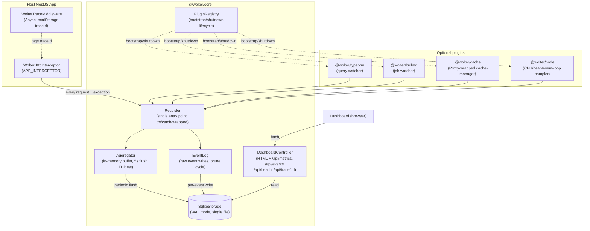

# Architecture

## Scope

Wolter is an embedded, self-hosted metrics/observability library for a single NestJS
application — not a hosted multi-tenant SaaS, not a distributed ingest pipeline. See the
README's "Explicitly out of scope" section; this document does not revisit those calls.

## Requirements

**Functional**
- Capture every inbound HTTP request (method, path, duration, status) and any exception
  thrown while handling it.
- Capture DB queries (TypeORM), background jobs (BullMQ), and cache hits/misses via
  optional plugins — a host app only pays for what it actually installs.
- Aggregate captured events into per-minute time-bucketed metrics (count, error/slow
  counts, duration percentiles) for trend charts.
- Retain a bounded window of raw per-occurrence events (headers/body/stack/parameters)
  for drill-down, correlated by trace ID across categories within one inbound request.
- Serve a bundled dashboard (server-rendered HTML + embedded JS, no separate frontend
  build/deploy) reading from the same storage.

**Non-functional**
- Near-zero overhead on the host app's request path — capture must never block or slow
  down the response, and a failure in Wolter itself must never surface to the host app
  (the "zero-impact guarantee" enforced throughout the codebase's own try/catch discipline).
- Zero external infrastructure dependency for v0.1 — no separate DB server, no message
  queue, no agent process to deploy/monitor.
- Safe defaults (dashboard guard required unless NODE_ENV is explicitly development/test
  or the host opts out with `dashboard.allowUnauthenticated`; SQLite-in-production surfaced
  as a loud warning rather than silently accepted).

## Current architecture

## Key decisions

See `docs/adr/` for the individual records. Index:

- [001 — SQLite as the only v0.1 storage driver](adr/001-sqlite-storage-driver.md)
- [002 — Embedded library, not a standalone agent process](adr/002-embedded-library-not-standalone-agent.md)
- [003 — Buffered in-memory aggregation, not write-through](adr/003-buffered-aggregation-not-write-through.md)
- [004 — AsyncLocalStorage for trace correlation](adr/004-async-local-storage-trace-correlation.md)
- [005 — Duck-typed plugin interface](adr/005-duck-typed-plugin-interface.md)

## Risks and mitigations

These are accepted trade-offs given the stated scope, not defects — flagged so they're
a deliberate, documented choice rather than a blind spot.

| Risk | Why it's accepted today | If it ever stops being acceptable |
|---|---|---|
| SQLite is single-writer — concurrent writes from a multi-process host (PM2 cluster mode, k8s replicas each with their own file) don't merge into one view | v0.1 targets a single app instance; `WolterModule`'s own one-instance-per-process guard already assumes this | Already possible: pass `storage: { driver: 'custom', instance }` in `forRoot()` with a Postgres/network `WolterStorageDriver` implementation |
| In-memory `Aggregator` buffer loses up to one bucket's worth of the *currently open* window on an unclean crash (SIGKILL, OOM) | `stop()` flushes synchronously on graceful shutdown; losing a few seconds of one metric bucket is tolerable for a dashboard, not a financial ledger | Shorten `FLUSH_INTERVAL_MS`, or add a write-ahead log, if the tolerance ever changes |
| No horizontal scaling story — each instance's dashboard only ever shows that instance's own traffic | Matches "single self-hosted app" scope explicitly (README's "out of scope" list rules out a standalone aggregator process) | A real scope change, not a bug fix — would need its own ADR |
